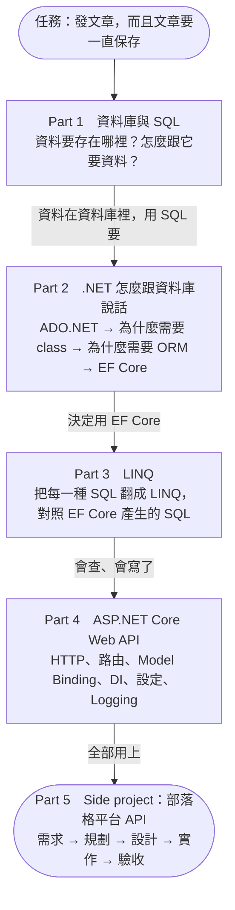

# 一個 Web API 怎麼運作

<!-- meta:start -->
Part 0　全景　·　單元 0-01　·　約 20 分鐘
<!-- meta:end -->

## 學完你會

- 看懂全景圖：前端送出請求，經過 API、EF Core、ADO.NET 到資料庫，再把結果送回前端
- 叫得出圖上每一塊的名字，知道它在這套課程的哪個 Part 會學到
- 知道這套課程怎麼走、練習專案在哪、最後要做出什麼

## 情境

你接到一個任務：

> 做一個**部落格平台的後端 API**：使用者可以開部落格、發文章、幫文章加標籤，讀者可以瀏覽文章。
> 明天主管會打開網站發一篇文章，**後天再打開，那篇文章必須還在。**

「發一篇文章」看起來很簡單：前端送來標題和內容，後端收下來就好。但「後天還要在」這句話，會把你從前端一路帶到資料庫。先看全景：主管按下「送出」後，這篇文章會經過哪些地方？

*圖 1　按下「送出」後，一篇文章從前端到資料庫、再把結果送回前端的完整來回*

| 步驟 | 發生什麼 | 在哪個單元學 |
|---|---|---|
| ① | 前端送出 **HTTP Request**：方法 `POST`、網址 `/posts`，內容是文章的 JSON | [4-01 HTTP](../04-web-api/01-http.md) |
| ② | 後端的 **Minimal API** 收到請求，把 JSON 轉成 `Post` 物件，交給 **EF Core**；EF Core 把「新增這個物件」翻成 SQL | [4-04 路由](../04-web-api/04-routing.md)、[Part 2](../02-dotnet-and-db/01-dotnet-and-database.md)、[Part 3](../03-linq/01-linq-to-sql.md) |
| ③ | EF Core 透過 **ADO.NET** 把 **SQL 文字**送到資料庫 | [2-02 ADO.NET](../02-dotnet-and-db/02-ado-net.md) |
| ④ | **資料庫**執行，把文章存下來，回傳結果（影響 1 列、新文章的編號） | [Part 1 SQL](../01-sql/01-tables.md) |
| ⑤ | 後端把結果包成 **HTTP Response** 回給前端：狀態碼 `201 Created` + JSON | [4-06 回應](../04-web-api/06-responses.md) |

後天主管再打開網站時，前端送出 `GET /posts`，走的是同一條路：後端透過 EF Core 送 `SELECT`，資料庫把存著的文章拿回來，再包成 Response 回給前端。

## 名詞地圖

圖上每一塊都有名字，之後會一直看到。現在不用懂，只要知道它們是什麼、在哪裡學：

| 名詞 | 是什麼 | 在哪學 |
|---|---|---|
| **前端 / Client** | 發出請求的那一方：瀏覽器、手機 App，測試時可以是 Rider 的 `.http` 檔 | [4-10](../04-web-api/10-testing.md) |
| **HTTP Request / Response** | 前後端之間來回的純文字訊息：方法、網址、狀態碼、JSON | [4-01](../04-web-api/01-http.md) |
| **ASP.NET Core** | 微軟的 Web 框架：接請求、找到該執行的程式、把結果回傳 | [4-02](../04-web-api/02-startup.md) |
| **Minimal API** | 在 ASP.NET Core 裡定義「哪個網址由哪段程式處理」的寫法 | [4-04](../04-web-api/04-routing.md) |
| **DI（依賴注入）** | 讓框架替你建立並傳入 DbContext 這類物件，你不用自己 `new` | [4-07](../04-web-api/07-di.md) |
| **EF Core** | ORM：把 C# 物件和 LINQ 翻成 SQL，把結果表翻回物件 | [Part 2](../02-dotnet-and-db/01-dotnet-and-database.md)、[Part 3](../03-linq/01-linq-to-sql.md) |
| **DbContext** | 程式跟資料庫打交道的入口，一次工作階段一個 | [2-06](../02-dotnet-and-db/06-dbcontext.md) |
| **LINQ** | C# 裡寫查詢的語法：`Where`、`Select`、`Include`…… | [Part 3](../03-linq/01-linq-to-sql.md) |
| **ADO.NET** | .NET 內建的資料庫連線 API；EF Core 底下就是它 | [2-02](../02-dotnet-and-db/02-ado-net.md) |
| **SQL** | 資料庫唯一聽得懂的語言 | [Part 1](../01-sql/01-tables.md) |
| **SQL Server / LocalDB** | 資料庫軟體；LocalDB 是給開發用的免設定版本 | [1-01](../01-sql/01-tables.md)、[0-02](02-lab-setup.md) |

> [!IMPORTANT]
> **這張圖要記住的一件事**
>
> 不管中間疊了多少層（Minimal API、EF Core、ADO.NET），最後跟資料庫說話的永遠是 **SQL 文字**，資料庫回來的永遠是**結果表**。所以這套課程從 SQL 開始學，LINQ 只是「用 C# 寫 SQL」的另一種方式。

## 這套課程怎麼走

照著全景圖從底層往上學，每一個 Part 解決前一個 Part 留下的問題：

*圖 2　五個 Part 的推理順序*

### 每個單元長一樣

| 段落 | 內容 |
|---|---|
| 學完你會 | 3–4 條可以勾選的具體能力 |
| 情境 | 從一個具體問題出發，不從名詞解釋開始 |
| 知識 | 能用圖就用圖，否則文字為主、圖為輔 |
| 動手 | 在練習專案或 Rider 裡實際做一次 |
| 常見的坑 | 新手最常踩的錯誤 |
| 小練習 | 先自己做，再展開解答 |
| 延伸閱讀 | 想深入時看 |
| 下一個問題 | 這一課留下的問題，引出下一課 |

每個單元 15–25 分鐘，**一次只學一個**。學完一個，回到[學習路線](../../README.md#學習路線)勾掉，再開下一個。

### 練習專案

`lab/` 是一個可以執行的 .NET 主控台程式，資料庫和範例資料都準備好了。每一課的範例一行指令就能跑，畫面會印出「你會寫的 SQL → LINQ → EF Core 實際產生的 SQL → 結果」。[0-02](02-lab-setup.md) 教你把它架起來。

### 最後要做出來的東西

Part 5 會把前面學的全部用上，做一個**部落格平台的 Web API**：建部落格、發文章、加標籤、依標籤找文章、分頁、統計。而且不是直接寫程式，而是走一遍真正的開發流程：**需求 → 規劃 → 設計 → 實作 → 驗收**。需求書已經寫好了，想先看終點長什麼樣可以翻 [5-01](../05-project/01-requirements.md)。

## 動手

1. 不看圖，在紙上把全景圖畫一次：前端、後端的三層、資料庫，標出 ① 到 ⑤。畫不出來的那一塊，就是之後要特別注意的。
2. 打開 `lab/` 資料夾看一眼結構（`Models/`、`Data/`、`Lessons/`），不用看懂，先有印象。

## 常見的坑

> [!WARNING]
> **以為用了 EF Core 就不用懂 SQL**
>
> EF Core 替你寫 SQL，不代表 SQL 消失了。查詢慢、結果不對、報錯時，你看到的還是 SQL。不懂 SQL 就看不懂 EF Core 在做什麼。

> [!WARNING]
> **以為 DbContext 就是資料庫**
>
> DbContext 是程式這一端的「入口」，資料庫是另一個程式。DbContext 裡的物件只是資料的**複本**，改了它不等於改了資料庫（[2-01](../02-dotnet-and-db/01-dotnet-and-database.md) 會講）。

## 小練習

**練習 1**　全景圖的五個步驟裡，哪些在講 HTTP，哪些在講 SQL？

看答案

① 和 ⑤ 是 HTTP（前端 ↔ 後端）；③ 和 ④ 是 SQL（後端 ↔ 資料庫）；② 是後端內部的轉換（JSON → 物件 → SQL）。

**練習 2**　如果有一天資料庫從 SQL Server 換成 PostgreSQL，圖上哪些地方要改？

看答案

資料庫本身、EF Core 的 Provider（換成 PostgreSQL 的）、連線字串。前端、Minimal API、LINQ、Entity class 幾乎都不用動。這就是 ORM 的價值之一（[2-04](../02-dotnet-and-db/04-why-orm.md)）。

**練習 3**　「後天再打開文章還在」是圖上哪一塊負責的？

看答案

資料庫。其他每一層都是「跑的時候才存在」的程式，程式重啟就什麼都不記得；只有資料庫把資料寫到磁碟上保存（[1-01](../01-sql/01-tables.md)）。

## 延伸閱讀

- [0-02 練習環境](02-lab-setup.md)：下一步
- [5-01 需求](../05-project/01-requirements.md)：最後要做的東西

> **下一個問題**：想親手看到這條路上的每一步，得先把練習環境架起來。

<!-- nav:start -->
---
[學習路線](../../README.md#學習路線)　｜　下一課：[練習環境：EfCoreLab](02-lab-setup.md) →
<!-- nav:end -->
