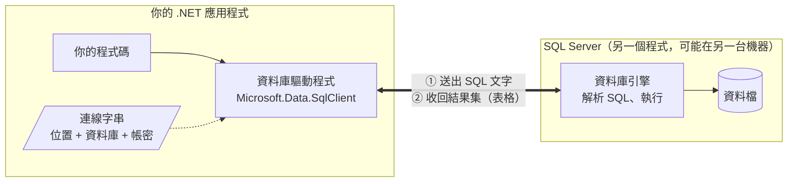
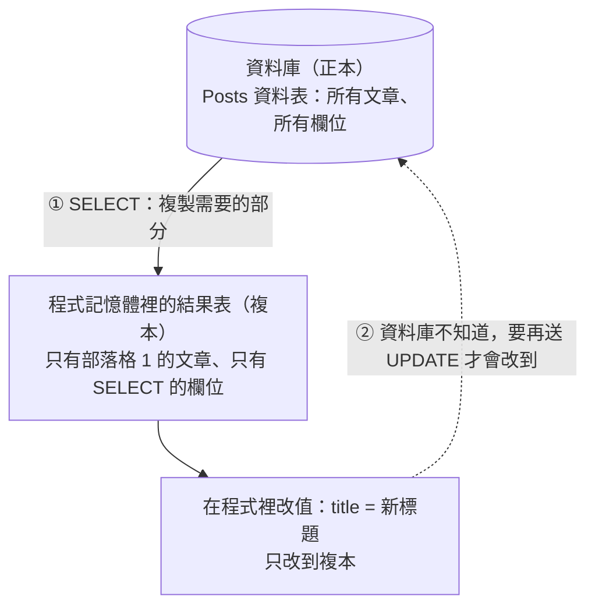

# .NET 與資料庫是什麼關係

<!-- meta:start -->
Part 2　.NET 怎麼跟資料庫說話　·　單元 2-01　·　約 20 分鐘
<!-- meta:end -->

## 學完你會

- 說出 .NET 程式和資料庫是兩個獨立的程式，中間靠什麼溝通
- 知道連線字串、驅動程式、SQL 三樣東西各自的角色
- 看懂「送出 SQL、收回結果表」實際上是什麼：結果集、游標、一格一格讀
- 知道拿回來的是複本，改了程式裡的值資料庫不會變

## 情境

Part 1 都是在 Rider 的 Database 視窗裡直接對資料庫下 SQL。但部落格平台是一個 .NET 程式，它要怎麼把 SQL 交給資料庫、又怎麼拿回結果？


*圖 1　這個 Part 要看的是後端和資料庫之間這一段*

## 兩個獨立的程式

.NET 程式和資料庫是兩個**獨立的程式**，就像瀏覽器和網站伺服器一樣，透過網路對話。資料庫可能跟你的程式在同一台機器（LocalDB），也可能在另一台伺服器上。



*圖 2　.NET 與資料庫：兩個程式透過網路，用 SQL 對話*

.NET 程式要跟資料庫說話，需要三樣東西：

| 要素 | 說明 | 比喻 |
|---|---|---|
| **連線字串** | 資料庫在哪台機器、哪個資料庫、用什麼帳號登入 | 地址 + 門禁卡 |
| **驅動程式**（ADO.NET Provider） | .NET 官方提供的連線元件，負責開連線、送出 SQL、接收結果。SQL Server 用 `Microsoft.Data.SqlClient` | 電話 |
| **SQL** | 資料庫**唯一**聽得懂的語言。查詢用 `SELECT`，新增用 `INSERT`…… | 雙方共通的語言 |

## 它們交換什麼：送出 SQL，收回結果表

程式和資料庫之間，來回交換的其實只有兩種東西：**程式送出去的 SQL 文字**，以及**資料庫送回來的查詢結果**。這份查詢結果的正式名稱叫**結果集（Result Set）**，拆成三步看：

**① 送出：一段 SQL 文字**

```sql
SELECT PostId, Title, PublishedOn
FROM Posts
WHERE BlogId = 1
```

**② 收回：一張結果表**

資料庫執行完，回傳的**不是 C# 物件**，因為資料庫根本不知道你寫了 `Post` 這個 class。它回傳的是一張表格：SELECT 指定的每個欄位成為一欄（帶著欄位名稱和**資料庫的型別**），每一筆符合條件的資料成為一列，沒有值的格子是 `NULL`。你在 Rider 執行 SQL 時下方跳出來的那張表，就是它。

| PostId（int） | Title（nvarchar） | PublishedOn（date） |
|---|---|---|
| 1 | EF Core 入門 | 2026-01-05 |
| 2 | LINQ 基礎 | 2026-01-12 |
| 4 | 草稿：Include 心得 | 2026-02-10 |

**③ 讀取：一次一列、一格一格**

程式透過一個叫 `SqlDataReader` 的東西讀這張表。reader 像一個**游標**，一次只指著一列：呼叫 `Read()` 就往下移一列，`reader["Title"]` 取出目前這一列某一格的值。取出來的型別是 `object`，要自己轉成 C# 的型別。

```csharp
while (reader.Read())     // 游標移到下一列
{
    var id    = (int)reader["PostId"];
    var title = (string)reader["Title"];
    // NULL 讀出來是 DBNull.Value，不是 C# 的 null，要另外判斷
}
```

| 資料庫型別 | 讀出來後要轉成的 C# 型別 | 要注意 |
|---|---|---|
| `int` | `int` | `bigint` 要轉成 `long`，轉錯型別會丟例外 |
| `nvarchar` | `string` | — |
| `date` / `datetime2` | `DateTime` | — |
| `bit` | `bool` | — |
| `NULL` | `DBNull.Value` | 不是 C# 的 `null`，直接轉型會丟例外 |

> [!NOTE]
> **不是每種 SQL 都會回傳表格**
>
> `SELECT` 回傳結果集。`INSERT`、`UPDATE`、`DELETE` 只回傳一個數字：**影響了幾列**。所以 ADO.NET 有兩種執行方法：讀表格用 `ExecuteReader`，只要筆數用 `ExecuteNonQuery`（下一課會用到）。

簡單說，「送 SQL、收表格」就是：**程式送出一段 SQL 文字，拿回一張結果表，再一列一列、一格一格把值讀出來。**

## 拿回來的是「複本」

查詢（`SELECT`）其實就是**把資料庫裡存的資料拿回來**。不過「拿回來」有三個細節，後面學 EF Core 時都會用到：

| 細節 | 說明 | 例子 |
|---|---|---|
| **只拿你要的部分** | SQL 就是用來描述「要哪些列、哪些欄」的語言，資料庫只回傳符合的部分 | 資料庫有上萬篇文章、十幾個欄位，`WHERE BlogId = 1` 只拿回部落格 1 的文章，而且只有 SELECT 列出的欄位 |
| **拿到的是複本** | 結果表是查詢那一刻的拷貝，放在程式的記憶體裡。改了程式裡的值，資料庫**不會**跟著變 | 讀出標題後在程式裡改成「新標題」，資料庫裡還是舊標題，必須另外送 `UPDATE` |
| **不一定原本就存著** | 結果也可以是資料庫當場算出來的 | `SELECT COUNT(*) FROM Posts` 拿回的「文章總數」不存在任何一格裡 |



*圖 3　查詢拿回的是複本：改複本不會改到資料庫*

> [!TIP]
> **先記住這個伏筆**
>
> 「改了複本，要自己送 UPDATE 回去」很麻煩，你還得記住改過哪些欄位。EF Core 的 **Change Tracker** 就是專門處理這件事的：它記住拿回來時的原始值，呼叫 `SaveChanges()` 時比對差異，自動組出 `UPDATE` 送回資料庫（[3-08](../03-linq/08-change-tracker.md)）。

一句話總結：**程式用 SQL 告訴資料庫「我要哪些資料」，資料庫把那部分複製一份、排成表格送回來。**

## 動手

1. 打開 `lab/EfCoreLab/Data/LabContext.cs`，找到連線字串，對照上面的表看每一段是什麼：`Server=(localdb)\mssqllocaldb`（在哪）、`Database=EfCoreLab`（哪個資料庫）、`Trusted_Connection=True`（用 Windows 帳號登入）。
2. 在 Rider 執行 `SELECT PostId, Title, PublishedOn FROM Posts WHERE BlogId = 1`，看那張結果表：它就是 Result Set，一會兒 .NET 程式會用 reader 一列一列讀它。
3. 在 Rider 執行 `SELECT COUNT(*) FROM Posts`：結果表只有一列一欄，值是 10，它不存在資料表的任何一格裡。

## 常見的坑

> [!WARNING]
> **連線字串打錯**
>
> 錯誤訊息是 `A network-related or instance-specific error occurred while establishing a connection to SQL Server`，意思是「照這個地址找不到資料庫」。檢查 `Server=` 的值、LocalDB 有沒有啟動（`sqllocaldb info`）、C# 或 JSON 字串裡的 `\` 有沒有寫成 `\\`。

> [!WARNING]
> **以為改了程式裡的值，資料庫就會變**
>
> 結果表是複本。改完要自己送 `UPDATE`（或之後用 EF Core 的 `SaveChanges()`），否則重新查一次還是舊的。

> [!WARNING]
> **把 NULL 當成 null**
>
> 結果表裡的 NULL 讀出來是 `DBNull.Value`，`(string)reader["Email"]` 會直接丟 `InvalidCastException`。要先用 `reader.IsDBNull(…)` 判斷。

## 小練習

**練習 1**　連線字串 `Server=db.example.com,1433;Database=Blogging;User Id=app;Password=secret;` 的四段各是什麼意思？

<details>
<summary>看答案</summary>

資料庫在 `db.example.com` 這台機器的 1433 埠；用 `Blogging` 這個資料庫；用帳號 `app`、密碼 `secret` 登入（不是 Windows 帳號）。

</details>

**練習 2**　`UPDATE Posts SET Views = Views + 1 WHERE PostId = 1` 送出去後，資料庫回什麼？

<details>
<summary>看答案</summary>

不是結果表，是一個數字：影響了幾列（這裡是 1）。程式用 `ExecuteNonQuery` 執行，拿到的回傳值就是這個數字。

</details>

**練習 3**　程式用 `SELECT Title FROM Posts` 拿回 10 個標題，然後在 C# 裡把第一個改成「新標題」。這時候再開 Rider 查一次，看到的是什麼？

<details>
<summary>看答案</summary>

舊標題。C# 改的是記憶體裡的複本，資料庫完全不知道這件事。

</details>

## 延伸閱讀

- [Microsoft.Data.SqlClient 與 ADO.NET 概觀（Microsoft Learn）](https://learn.microsoft.com/sql/connect/ado-net/microsoft-ado-net-sql-server)

> **下一個問題**：知道原理了，實際用 .NET 內建的 ADO.NET 寫一次「送 SQL、收表格」長什麼樣？

<!-- nav:start -->
---
← 上一課：[索引入門](../01-sql/12-index.md)（尚未推出）　｜　[學習路線](../../README.md#學習路線)　｜　下一課：[ADO.NET：最原始的寫法](02-ado-net.md) →
<!-- nav:end -->
