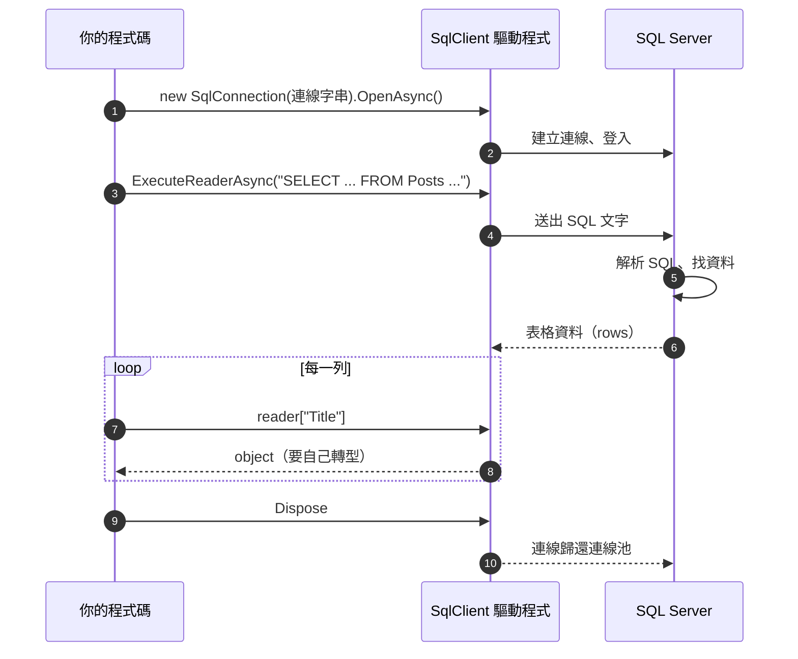

# ADO.NET：最原始的寫法

<!-- meta:start -->
Part 2　.NET 怎麼跟資料庫說話　·　單元 2-02　·　約 20 分鐘　·　練習專案：`dotnet run -- ado`
<!-- meta:end -->

## 學完你會

- 用 ADO.NET 三個物件（`SqlConnection`、`SqlCommand`、`SqlDataReader`）把資料存進去、讀出來
- 知道參數化查詢是什麼、為什麼一定要用
- 親手踩到「欄位名打錯字執行才爆」和「NULL 不是 null」這兩個坑
- 分清楚 `ExecuteReader`、`ExecuteNonQuery`、`ExecuteScalar` 什麼時候用哪個

## 情境

[2-01](01-dotnet-and-database.md) 說程式跟資料庫之間只有「送 SQL 文字、收結果表」。.NET 內建做這件事的 API 叫 **ADO.NET**，所有 .NET 的資料庫存取（包括 EF Core）底下都是它。先用最原始的方式寫一次，之後才會知道 ORM 到底幫你省了什麼。

## 三個物件

| 物件 | 負責 | 對應到 |
|---|---|---|
| `SqlConnection` | 依連線字串跟資料庫建立連線 | 打電話 |
| `SqlCommand` | 一段要執行的 SQL，加上參數 | 要說的話 |
| `SqlDataReader` | 讀結果表的游標，一次一列 | 對方的回答，一句一句聽 |

把文章存進去、再讀出來：

```csharp
using Microsoft.Data.SqlClient;

var connectionString = "Server=(localdb)\\mssqllocaldb;Database=EfCoreLab;Trusted_Connection=True;TrustServerCertificate=True;";
using var conn = new SqlConnection(connectionString);
await conn.OpenAsync();                                                // ① 連線

// 寫入：自己組 INSERT
var insert = new SqlCommand(
    "INSERT INTO Posts (Title, Content, PublishedOn, Views, BlogId) VALUES (@title, @content, @date, 0, @blogId)", conn);
insert.Parameters.AddWithValue("@title", "EF Core 入門");              // 參數化，防 SQL Injection
insert.Parameters.AddWithValue("@content", "今天來介紹…");
insert.Parameters.AddWithValue("@date", DateTime.Today);
insert.Parameters.AddWithValue("@blogId", 1);
await insert.ExecuteNonQueryAsync();                                   // ② 送出 SQL，只回「影響幾列」

// 讀取：自己組 SELECT，再一格一格讀
var select = new SqlCommand("SELECT PostId, Title, Content FROM Posts WHERE BlogId = @blogId", conn);
select.Parameters.AddWithValue("@blogId", 1);
using var reader = await select.ExecuteReaderAsync();                  // ③ 收回結果表
while (await reader.ReadAsync())                                       // 一次讀一列
{
    var id    = (int)reader["PostId"];                                 // 用欄位名稱字串取值
    var title = (string)reader["Title"];                               // 自己轉型
}
```



*圖 1　ADO.NET 讀取資料的過程*

### 三種執行方法

| 方法 | 用在 | 回傳 |
|---|---|---|
| `ExecuteReader` | `SELECT`，要結果表 | `SqlDataReader` |
| `ExecuteNonQuery` | `INSERT` / `UPDATE` / `DELETE` | 影響的列數（`int`） |
| `ExecuteScalar` | 只要結果表左上角那一格，例如 `SELECT COUNT(*)` | `object` |

### 參數化查詢

`@title`、`@blogId` 是**參數**：SQL 文字裡留一個位置，值另外傳。千萬不要用字串拼接：

```csharp
// ✗ 絕對不要這樣：使用者輸入 ' OR 1=1 -- 就能改掉整句 SQL（SQL Injection）
var cmd = new SqlCommand("SELECT * FROM Posts WHERE Title = '" + input + "'", conn);

// ✓ 參數化：值永遠是值，不會被當成 SQL 的一部分
var cmd = new SqlCommand("SELECT * FROM Posts WHERE Title = @title", conn);
cmd.Parameters.AddWithValue("@title", input);
```

> [!NOTE]
> **記住這張圖**
>
> 不管之後用什麼工具（包括 EF Core），底層永遠是這件事：**送出 SQL 文字，收回表格資料**。EF Core 本身就是建立在 ADO.NET 之上，它最後也是透過 `Microsoft.Data.SqlClient` 跟 SQL Server 說話，而且它產生的 SQL 一律是參數化的。

## 動手

練習專案有一課完全不用 EF Core：

```bash
cd lab/EfCoreLab
dotnet run -- ado
```

它會依序做五件事，每一件都對應上面的觀念：

| 步驟 | 做什麼 | 看到什麼 |
|---|---|---|
| ① | `ExecuteReader` 讀部落格 1 的文章，一列一列 `(int)reader["PostId"]` | 4 筆，每一格都要自己轉型 |
| ② | 故意寫 `reader["Tilte"]` | 編譯沒問題，執行時 `IndexOutOfRangeException: Tilte` |
| ③ | 讀 `Authors` 的 `Email` | 小華那一列讀出來的型別是 `DBNull`，不是 `null` |
| ④ | `ExecuteNonQuery` 執行 `UPDATE` | 回傳 `1`（影響 1 列），不是結果表；程式用交易 Rollback 還原，資料不會真的被改 |
| ⑤ | `ExecuteScalar` 執行 `SELECT COUNT(*)` | 回傳 `10`，這個數字不存在任何一格裡 |

打開 `lab/EfCoreLab/Lessons/AdoNet.cs` 對照程式碼。試著把 ① 的 `@blogId` 改成 2，再執行一次。

## 常見的坑

> [!WARNING]
> **欄位名稱是字串，打錯字編譯不會發現**
>
> `reader["Tilte"]` 要等程式跑到那一行才爆。這是 ADO.NET 最大的痛點，也是下一課「為什麼需要 class」的起點。

> [!WARNING]
> **NULL 讀出來是 `DBNull.Value`**
>
> `(string)reader["Email"]` 在 NULL 那一列會丟 `InvalidCastException`。要先 `reader.IsDBNull(index)` 判斷，或用 `reader["Email"] as string`。

> [!WARNING]
> **忘了關連線**
>
> 連線是有限資源（連線池預設 100 條）。沒 Dispose 的連線不會歸還，用完就會卡住。一律用 `using`，離開範圍自動歸還。

> [!WARNING]
> **用字串拼接組 SQL**
>
> 這是 SQL Injection 的來源，也是資安考試最常考的題目。任何來自外部的值都走參數。

## 小練習

解答都能用 `dotnet run -- ado --ex` 執行。

**練習 1**　用 ADO.NET 列出所有標籤的 `TagId` 與 `Name`。

<details>
<summary>看答案</summary>

```csharp
using var cmd = new SqlCommand("SELECT TagId, Name FROM Tags", conn);
using var reader = cmd.ExecuteReader();
while (reader.Read())
    Console.WriteLine($"{reader.GetInt32(0)} {reader.GetString(1)}");
```

`GetInt32(0)` 用「第幾欄」取值，比 `(int)reader["TagId"]` 快一點，但換了 SELECT 的欄位順序就錯位。

</details>

**練習 2**　找出沒有作者的文章（`AuthorId` 是 NULL），用 `IsDBNull` 判斷。

<details>
<summary>看答案</summary>

```csharp
using var cmd = new SqlCommand("SELECT PostId, Title, AuthorId FROM Posts", conn);
using var reader = cmd.ExecuteReader();
while (reader.Read())
    if (reader.IsDBNull(2))
        Console.WriteLine($"{reader.GetInt32(0)} {reader.GetString(1)}");
```

結果是第 7、9、10 篇。SQL 其實可以直接寫 `WHERE AuthorId IS NULL`（[1-03](../01-sql/03-where.md)），讓資料庫篩選比抓回來再判斷好得多；這裡故意在 C# 端判斷，體會一下差別。

</details>

**練習 3**　上面的 INSERT 範例如果要拿到新文章的 `PostId`，該怎麼改？

<details>
<summary>提示</summary>

SQL Server 的 `INSERT ... OUTPUT INSERTED.PostId VALUES (...)` 會把新列的主鍵當成結果回傳。

</details>

<details>
<summary>看答案</summary>

```csharp
var insert = new SqlCommand(
    "INSERT INTO Posts (Title, Content, PublishedOn, Views, BlogId) " +
    "OUTPUT INSERTED.PostId VALUES (@title, @content, @date, 0, @blogId)", conn);
// ...加參數...
var newId = (int)await insert.ExecuteScalarAsync();   // 只要那一格，用 ExecuteScalar
```

EF Core 幫你新增時，就是用這種方式把自動產生的主鍵填回物件（[3-07](../03-linq/07-add-update-delete.md)）。

</details>

## 延伸閱讀

- [ADO.NET 概觀（Microsoft Learn）](https://learn.microsoft.com/dotnet/framework/data/adonet/ado-net-overview)
- [Microsoft.Data.SqlClient（Microsoft Learn）](https://learn.microsoft.com/sql/connect/ado-net/microsoft-ado-net-sql-server)

> **下一個問題**：資料庫回來的是「一格一格的值」，但程式想處理的是「一篇文章」。這中間的落差怎麼辦？

<!-- nav:start -->
---
← 上一課：[.NET 與資料庫是什麼關係](01-dotnet-and-database.md)　｜　[學習路線](../../README.md#學習路線)　｜　下一課：[為什麼需要 class：Entity](03-why-class.md) →
<!-- nav:end -->
