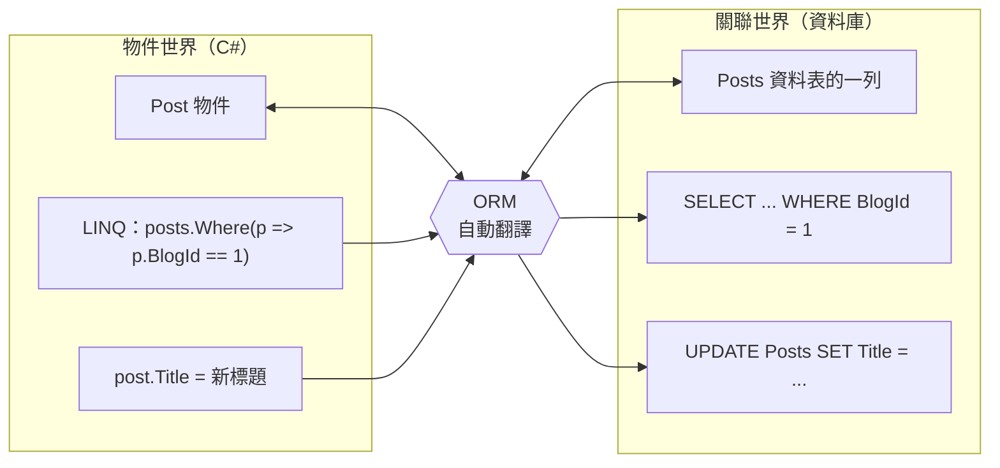

# 為什麼需要 ORM

<!-- meta:start -->
Part 2　.NET 怎麼跟資料庫說話　·　單元 2-04　·　約 20 分鐘
<!-- meta:end -->

## 學完你會

- 列出「ADO.NET + class」還剩下哪些重複的苦工
- 說出 ORM 是什麼、它在物件世界和關聯世界之間做什麼翻譯
- 比較 .NET 的三種選擇：ADO.NET、Dapper、EF Core，知道各適合什麼
- 知道 ORM 的代價，不把它當魔法

## 情境

[2-03](03-why-class.md) 用 class 承接結果表之後，讀取變好用了。但把「ADO.NET + class」套到整個部落格平台，看看還剩下多少重複的苦工：

| 情境 | ADO.NET + class 要做的事 |
|---|---|
| 新增一個查詢 | 寫 SQL 字串 + 加參數 + 寫一段「一列 → 物件」的轉換 |
| 改了文章標題要存回去 | 自己記得哪些屬性改過，組出 `UPDATE Posts SET Title = @t WHERE PostId = @id` |
| 讀部落格順便帶出所有文章 | 寫 JOIN，再把攤平的結果手動組回「Blog 底下有 List\<Post\>」 |
| class 加了一個屬性 | 自己寫 `ALTER TABLE`，還要記得每台環境的資料庫都要執行 |
| 同時新增文章和標籤 | 自己開交易、依序 INSERT、出錯時自己 Rollback |

你會發現：**class 已經描述了資料的形狀，這些 SQL 和轉換其實都能從 class 推導出來。**既然能推導，就交給工具自動做。這種工具叫 **ORM（Object-Relational Mapper，物件關聯對映）**。

## ORM 做的事：兩個世界之間的翻譯

C# 活在「物件世界」：物件、屬性、方法呼叫。資料庫活在「關聯世界」：資料表、列、SQL。ORM 就夾在中間翻譯：



*圖 1　ORM 做的事：物件世界與關聯世界之間的翻譯*

放回分層來看，ORM 插在你的程式和 ADO.NET 之間：


*圖 2　有了 ORM，你只跟 EF Core 打交道。虛線框是「你不用直接碰的部分」，其中只有粉紅色那層是 ORM，ADO.NET 仍是底層驅動*

### 同一件事，有沒有 ORM 的差別

**ADO.NET + class**

```csharp
var cmd = new SqlCommand(
    "SELECT PostId, Title, Content, BlogId " +
    "FROM Posts WHERE BlogId = @id", conn);
cmd.Parameters.AddWithValue("@id", 1);
using var reader = await cmd.ExecuteReaderAsync();
var posts = new List<Post>();
while (await reader.ReadAsync())
    posts.Add(new Post
    {
        PostId  = reader.GetInt32(0),
        Title   = reader.GetString(1),
        Content = reader.IsDBNull(2) ? null : reader.GetString(2),
        BlogId  = reader.GetInt32(3),
    });
```

**EF Core**

```csharp
var posts = await db.Posts
    .Where(p => p.BlogId == 1)
    .ToListAsync();

// 改標題並存回：EF 自己知道要 UPDATE 哪個欄位
posts[0].Title = "新標題";
await db.SaveChangesAsync();
```

| 苦工 | EF Core 怎麼處理 | 在哪學 |
|---|---|---|
| 寫 SQL | LINQ 自動轉譯成 SQL，預設參數化（防 SQL Injection） | [3-01](../03-linq/01-linq-to-sql.md) |
| 一列 → 物件 | 自動實體化（Materialization） | [3-01](../03-linq/01-linq-to-sql.md) |
| 判斷改了什麼、組 UPDATE | Change Tracker 自動比對 | [3-08](../03-linq/08-change-tracker.md) |
| JOIN 後組回物件 | `Include(b => b.Posts)` | [3-11](../03-linq/11-include.md) |
| 改表結構 | Migration 依 class 產生，並保留版本紀錄 | [5-04](../05-project/04-scaffold.md) |
| 交易 | 一次 `SaveChanges` 就是一個交易 | [3-16](../03-linq/16-write-relationships.md) |

## .NET 常見的三種選擇

| | ADO.NET | Dapper（Micro-ORM） | EF Core（完整 ORM） |
|---|---|---|---|
| SQL 誰寫 | 自己 | 自己 | 自動產生（也可自己寫） |
| 結果 → 物件 | 手動 | ✓ | ✓ |
| 變更追蹤 | ✗ | ✗ | ✓ |
| Migration | ✗ | ✗ | ✓ |
| 執行效能 | 最快 | 接近 ADO.NET | 稍慢（多一層轉譯與追蹤） |
| 開發速度 | 慢 | 中 | 快 |
| 適合 | 極致效能、底層工具 | 複雜報表、手調 SQL | 以 CRUD 與商業邏輯為主的應用（例如我們的部落格平台） |

這套課程選 EF Core：它是 .NET 官方的 ORM、功能最完整、部落格平台這種以新增查詢修改為主的應用正好是它的強項。Dapper 值得知道，之後遇到複雜報表或效能瓶頸時，同一個專案裡可以混用。

> [!WARNING]
> **ORM 不是魔法，也有代價**
>
> **效能開銷**：多了轉譯與變更追蹤。純讀取時可加 `AsNoTracking()`（[3-08](../03-linq/08-change-tracker.md)）。
>
> **產生的 SQL 不一定最好**：最常見的是 **N+1 問題**，在迴圈裡讀導覽屬性，每筆都多發一次查詢（[3-13](../03-linq/13-projection-vs-include.md)）。
>
> **還是要懂 SQL**：底層仍是送 SQL、收表格。看不懂 EF Core 產生的 SQL，就不知道它慢在哪、錯在哪。這就是 Part 1 先學 SQL 的原因。
>
> **可以混用**：EF Core 也能執行自寫 SQL（[3-17](../03-linq/17-advanced.md)），同一個專案也能搭配 Dapper。

## 動手

練習專案剛好有兩課做同一件事：

```bash
cd lab/EfCoreLab
dotnet run -- ado           # ADO.NET：自己送 SQL、自己讀
dotnet run -- linq-select   # EF Core：寫 LINQ，看它產生的 SQL
```

打開 `Lessons/AdoNet.cs` 和 `Lessons/LinqSelect.cs` 並排比較：同樣是「讀出部落格的資料」，程式碼差了幾行？哪些事在 EF Core 版本裡消失了？

## 常見的坑

> [!WARNING]
> **把 ORM 當黑盒，不看它產生的 SQL**
>
> 「反正 EF Core 會處理」是效能問題的起點。養成習慣：寫完查詢用 `ToQueryString()` 或 log 看一眼 SQL（[0-02](../00-overview/02-lab-setup.md)）。

> [!WARNING]
> **以為有了 ORM 就不會有 SQL Injection**
>
> EF Core 的 LINQ 一律參數化，這部分安全；但如果用自寫 SQL 的功能又用字串拼接，一樣會中。用 `FromSqlInterpolated` 這種會自動參數化的寫法。

## 小練習

**練習 1**　下面三件事，哪些 EF Core 會自動做、哪些還是要你自己做？（a）把 `Where(p => p.Views > 100)` 翻成 SQL；（b）決定文章列表要不要分頁；（c）把 `UPDATE` 送回資料庫。

<details>
<summary>看答案</summary>

（a）自動；（c）自動（`SaveChanges()`）；（b）你自己：ORM 翻譯你寫的查詢，不會替你決定業務邏輯。

</details>

**練習 2**　什麼情況下你會在 EF Core 專案裡額外用 Dapper？

<details>
<summary>看答案</summary>

需要手寫複雜 SQL 的地方：報表、統計、效能關鍵的查詢，或 LINQ 翻不出來的 SQL 功能（視窗函式、CTE）。一般的 CRUD 仍用 EF Core。

</details>

**練習 3**　為什麼說「用了 ORM 還是要懂 SQL」？舉一個具體情境。

<details>
<summary>看答案</summary>

例如列表頁突然變慢：你得看 EF Core 產生的 SQL 才會發現它在迴圈裡送了 11 次查詢（N+1），或少了索引。看不懂 SQL 就只能猜。

</details>

## 延伸閱讀

- [EF Core 概觀（Microsoft Learn）](https://learn.microsoft.com/ef/core/)
- [Dapper（GitHub）](https://github.com/DapperLib/Dapper)：Micro-ORM 的代表

> **下一個問題**：決定用 EF Core 了。它內部由哪些零件組成？哪些部分是 ORM、哪些不是？

<!-- nav:start -->
---
← 上一課：[為什麼需要 class：Entity](03-why-class.md)　｜　[學習路線](../../README.md#學習路線)　｜　下一課：[EF Core 的組成](05-ef-core-anatomy.md) →
<!-- nav:end -->
