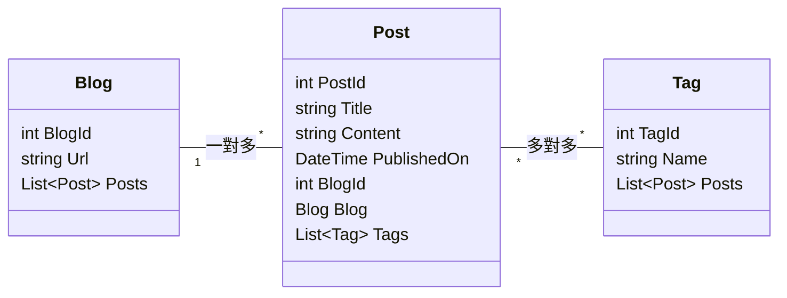
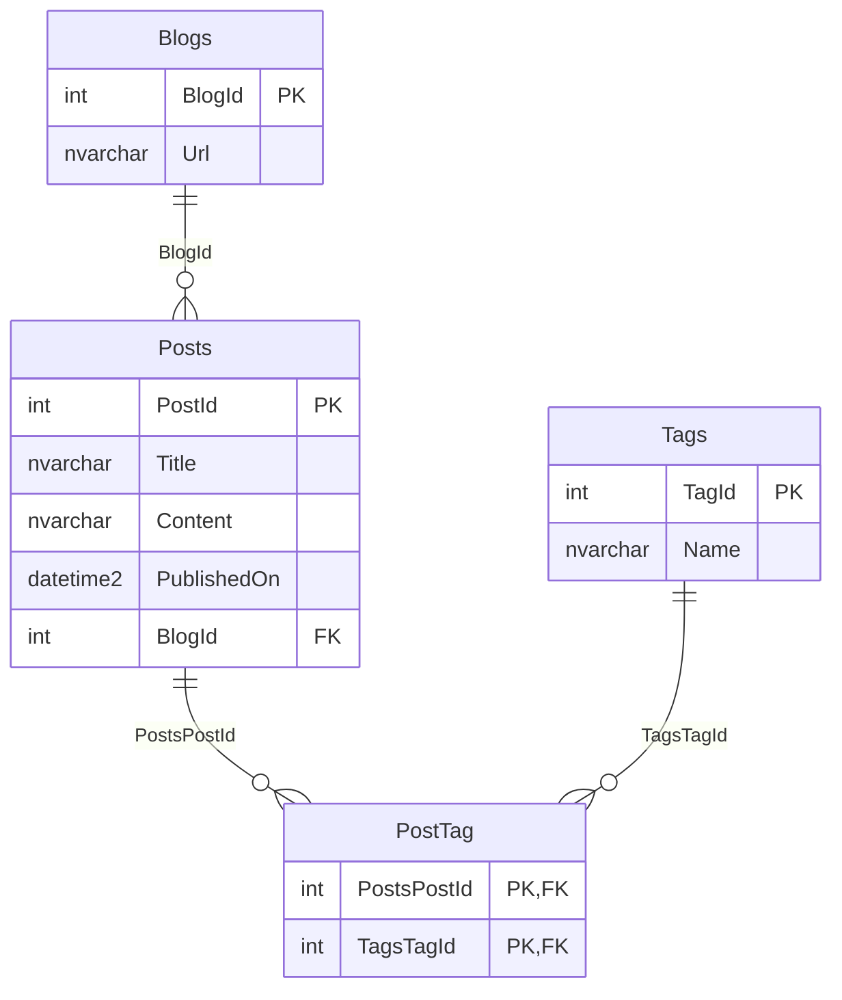

# class 怎麼對應到資料表

<!-- meta:start -->
Part 2　.NET 怎麼跟資料庫說話　·　單元 2-07　·　約 20 分鐘
<!-- meta:end -->

## 學完你會

- 說出 EF Core 怎麼從一個 class 推導出資料表：主鍵、欄位、型別、外鍵
- 知道三層設定的優先順序：慣例 → Data Annotations → Fluent API
- 在 `OnModelCreating` 用 Fluent API 設定必填、長度、唯一索引
- 看懂練習專案的 `LabContext.OnModelCreating`

## 情境

[2-03](03-why-class.md) 是先有資料表、再手寫 class 去對應。EF Core 反過來：**依照 class 推導出資料表**（Code First）。但 class 裡只有屬性名稱和型別，EF Core 怎麼知道哪個是主鍵、`Title` 最多幾個字、`Url` 不能重複？

## 兩端各長什麼樣

以 `Blog`、`Post`、`Tag` 為例：



*圖 1　C# 端：Entity 與導覽屬性*



*圖 2　資料庫端：EF Core 依 class 產生的資料表*

> [!TIP]
> **觀察重點**
>
> **導覽屬性不會變成欄位**：`Blog.Posts`、`Post.Blog` 只存在 C# 端，資料庫只有外鍵 `Posts.BlogId`。
>
> **多對多會多一張中間表**：C# 兩邊各放一個 `List`，EF Core 自動建立 `PostTag`。
>
> **主鍵慣例**：名為 `Id` 或 `<類別名>Id` 的屬性會自動成為主鍵，`int` 主鍵預設為自動遞增。

## 三層設定：慣例 → Annotations → Fluent API

EF Core 先套用**慣例（Convention）**，猜不到或猜錯的地方再由你用 **Data Annotations** 或 **Fluent API** 覆寫。

### 慣例：什麼都不寫時的預設

| 慣例 | 效果 |
|---|---|
| 屬性名為 `Id` 或 `<類別名>Id` | 成為主鍵；`int` / `long` / `Guid` 會自動產生值 |
| 屬性名為 `<導覽屬性名>Id`，型別與對方主鍵相同 | 成為外鍵（`Post.BlogId` 配 `Post.Blog`） |
| 兩邊都有集合導覽屬性 | 多對多，自動建立中間表 |
| 可為 null 的型別（`int?`、`string?`） | 欄位允許 NULL；不可為 null 的就是 NOT NULL |
| `string` 沒指定長度 | `nvarchar(max)` |
| `DbSet` 屬性名稱 | 資料表名稱（`Blogs`） |
| C# 型別 | `int` → `int`、`string` → `nvarchar`、`DateTime` → `datetime2`、`bool` → `bit`、`decimal` → `decimal(18,2)` |

慣例能處理八成的情況，所以 Entity 可以保持很乾淨。

### Data Annotations：寫在 class 上

```csharp
public class Blog
{
    public int BlogId { get; set; }

    [Required, MaxLength(200)]
    public string Url { get; set; } = null!;
}
```

優點是看 class 就知道規則；缺點是能設定的東西有限（唯一索引、刪除行為、預設值 SQL 都做不到），而且把資料庫細節混進 Entity。

### Fluent API：集中在 DbContext

```csharp
protected override void OnModelCreating(ModelBuilder modelBuilder)
{
    modelBuilder.Entity<Blog>(eb =>
    {
        eb.Property(b => b.Url).IsRequired().HasMaxLength(200);
        eb.HasIndex(b => b.Url).IsUnique();
    });
}
```

什麼都能設定，而且所有對映規則集中在一個地方。兩種方式可以混用，**衝突時 Fluent API 優先**。這套課程以 Fluent API 為主。

### 常用的 Fluent API

| 方法 | 效果 | 資料庫 |
|---|---|---|
| `HasKey(x => x.Code)` | 指定主鍵（慣例猜不到時） | PRIMARY KEY |
| `IsRequired()` | 必填 | NOT NULL |
| `HasMaxLength(200)` | 最長 200 字 | `nvarchar(200)` |
| `HasColumnType("varchar(200)")` | 直接指定 SQL 型別 | `varchar(200)` |
| `HasColumnName("blog_url")` | 欄位改名 | 欄位名稱 |
| `HasPrecision(18, 2)` | decimal 精度 | `decimal(18,2)` |
| `HasDefaultValue(0)` / `HasDefaultValueSql("getutcdate()")` | 預設值 | DEFAULT |
| `HasIndex(x => x.Url).IsUnique()` | 唯一索引 | UNIQUE INDEX |
| `ToTable("blog")` | 資料表改名 | 資料表名稱 |
| `HasOne / HasMany / WithOne / WithMany` | 設定關聯 | FOREIGN KEY（[3-10](../03-linq/10-relationships.md)） |
| `OnDelete(DeleteBehavior.Cascade)` | 刪除行為 | ON DELETE CASCADE |

## 練習專案的設定

`lab/EfCoreLab/Data/LabContext.cs` 的 `OnModelCreating`（節錄）：

```csharp
modelBuilder.Entity<Blog>(eb =>
{
    eb.Property(b => b.Url).IsRequired().HasMaxLength(200);   // Url 必填、最長 200
    eb.HasIndex(b => b.Url).IsUnique();                       // 網址不可重複
    // ...關聯設定見 3-10
});

modelBuilder.Entity<Post>(eb =>
{
    eb.Property(p => p.Title).IsRequired().HasMaxLength(200);
    eb.Property(p => p.PublishedOn).HasColumnType("date");    // 只要日期，不要時間
});

modelBuilder.Entity<Tag>(eb =>
{
    eb.Property(t => t.Name).IsRequired().HasMaxLength(50);
    eb.HasIndex(t => t.Name).IsUnique();                      // 標籤名稱不可重複
});
```

對照 [1-01](../01-sql/01-tables.md) 在 Rider 看到的欄位：`Title nvarchar(200) NOT NULL`、`PublishedOn date`，就是這幾行設定的結果。而 `Url` 上的唯一索引，正是 [1-02](../01-sql/02-select.md) 裡「查詢順序變了」的原因。

## 動手

1. 打開 `lab/EfCoreLab/Data/LabContext.cs`，把每一行 Fluent API 對照上面的表，說出它在資料庫產生了什麼。
2. 在 Rider 的 Database 視窗展開 `Posts` → `columns`，確認 `Content` 是 `nvarchar(max)`（沒設長度的慣例）、`Views` 是 `int NOT NULL`（`int` 不可為 null）。
3. 展開 `Blogs` → `indexes`，看到 `IX_Blogs_Url`（unique）。

> [!NOTE]
> **改了設定，資料表不會自己變**
>
> 練習專案用 `EnsureCreated` 建庫，改設定後要 `dotnet run -- reset` 重建。正式專案用 Migration 一步一步改表，[5-04](../05-project/04-scaffold.md) 會講。

## 常見的坑

> [!WARNING]
> **`string` 忘了給長度**
>
> 慣例是 `nvarchar(max)`：佔空間、不能建索引、也等於沒有任何長度限制。除了真正不限長度的內容，都給 `HasMaxLength`。

> [!WARNING]
> **Annotations 和 Fluent API 各寫一套，互相打架**
>
> `[MaxLength(100)]` 配 `HasMaxLength(200)`，結果是 200（Fluent 優先），但看 class 的人會以為是 100。選一種為主，這套課程用 Fluent API。

> [!WARNING]
> **主鍵不符合慣例又沒指定**
>
> 屬性叫 `Code` 或 `Key`，EF Core 猜不到主鍵，執行時丟 `The entity type 'X' requires a primary key to be defined`。用 `HasKey` 指定，或改名成 `Id`。

## 小練習

**練習 1**　用 Fluent API 設定：`Author.Name` 必填、最長 50；`Author.Email` 最長 100、不可重複（但允許 NULL）。

<details>
<summary>看答案</summary>

```csharp
modelBuilder.Entity<Author>(eb =>
{
    eb.Property(a => a.Name).IsRequired().HasMaxLength(50);
    eb.Property(a => a.Email).HasMaxLength(100);
    eb.HasIndex(a => a.Email).IsUnique();
});
```

`Email` 是 `string?`，慣例就允許 NULL；唯一索引在 SQL Server 預設只允許一個 NULL，多個作者沒 Email 會撞到，這是之後要處理的細節（可用 `.HasFilter("[Email] IS NOT NULL")`）。

</details>

**練習 2**　`Post` 有 `int BlogId` 和 `Blog Blog` 兩個屬性，為什麼不用寫任何設定 EF Core 就知道 `BlogId` 是外鍵？

<details>
<summary>看答案</summary>

慣例：屬性名 = `<導覽屬性名>Id`（`Blog` + `Id`），型別又跟 `Blog` 的主鍵一樣是 `int`，EF Core 就認定它是指向 `Blogs` 表的外鍵。

</details>

**練習 3**　想把 `Blogs` 表改名成 `blog`、`Url` 欄位改名成 `blog_url`（配合某些資料庫的小寫慣例），怎麼寫？

<details>
<summary>看答案</summary>

```csharp
modelBuilder.Entity<Blog>(eb =>
{
    eb.ToTable("blog");
    eb.Property(b => b.Url).HasColumnName("blog_url");
});
```

C# 程式還是用 `db.Blogs` 和 `b.Url`，對映由 EF Core 處理。

</details>

## 延伸閱讀

- [EF Core：建立模型（慣例、Data Annotations、Fluent API）](https://learn.microsoft.com/ef/core/modeling/)
- [EF Core：關聯設定](https://learn.microsoft.com/ef/core/modeling/relationships)（[3-10](../03-linq/10-relationships.md) 會用到）

> **下一個問題**：class 和資料表對上了。那寫一段 LINQ 的時候，EF Core 到底怎麼把它變成 SQL、又怎麼把結果表變回物件？

<!-- nav:start -->
---
← 上一課：[DbContext 與 DbSet](06-dbcontext.md)　｜　[學習路線](../../README.md#學習路線)　｜　下一課：[LINQ 怎麼變成 SQL](../03-linq/01-linq-to-sql.md) →
<!-- nav:end -->
