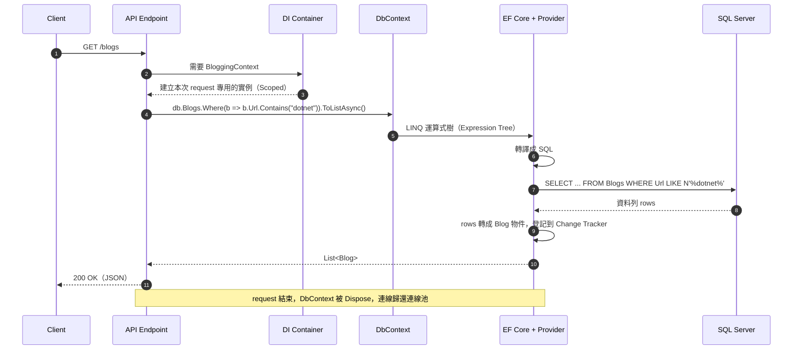

# LINQ 怎麼變成 SQL

<!-- meta:start -->
Part 3　LINQ：把 SQL 翻成 LINQ　·　單元 3-01　·　約 20 分鐘
<!-- meta:end -->

## 學完你會

- 說出一段 LINQ 從寫下來到拿回物件，中間經過哪幾步
- 知道哪一行程式才真的把 SQL 送出去
- 用 `ToQueryString()` 和 Logging 兩種方法看 EF Core 產生的 SQL
- 知道 EF Core 翻得出什麼、翻不出什麼

## 情境

[2-04](../02-dotnet-and-db/04-why-orm.md) 說 EF Core 會「自動翻譯」。但它怎麼翻的？你寫 `db.Blogs.Where(b => b.Url.Contains("dotnet"))`，資料庫收到的是什麼？什麼時候收到？這一課先把這條路看清楚，接下來十幾課每一課都會沿著它走。

## 一次查詢的五步



*圖 1　一次查詢的時序：這其實就是 [2-01](../02-dotnet-and-db/01-dotnet-and-database.md) 的「送 SQL、收結果表」加上 [2-03](../02-dotnet-and-db/03-why-class.md) 的「一列裝進一個物件」，只是 EF Core 全部自動做完*

| 步驟 | 發生什麼 | 名詞 |
|---|---|---|
| 1 | 你寫的 `Where(b => b.Url.Contains("dotnet"))` 不是立刻執行的程式，而是被存成一棵「描述你想做什麼」的樹 | 運算式樹（Expression Tree） |
| 2 | EF Core 走訪這棵樹，查模型（哪個屬性對哪個欄位），Provider 決定 SQL 方言：`Contains` → `LIKE N'%dotnet%'` | 轉譯（Translation） |
| 3 | 透過 ADO.NET 送出 SQL，拿回結果表 | 執行 |
| 4 | 結果表的每一列變成一個 `Blog` 物件 | 實體化（Materialization） |
| 5 | 物件登記到 Change Tracker（之後改了它，`SaveChanges` 才知道） | 追蹤（Tracking，[3-09](09-change-tracker.md)） |

## 哪一行才真的送 SQL

`Where`、`Select`、`OrderBy` 這些方法**只是在組裝運算式樹**，不會連資料庫。直到遇到「要結果」的方法，EF Core 才一口氣翻譯、送出：

| 這些只是組裝（不送 SQL） | 這些才送 SQL（執行） |
|---|---|
| `Where`、`Select`、`OrderBy`、`Skip`、`Take`、`Include` | `ToList()` / `ToListAsync()`、`First()`、`Single()`、`Count()`、`Any()`、`foreach` 開始迭代 |

```csharp
var query = db.Blogs.Where(b => b.Url.Contains("dotnet"));   // 還沒送：query 是「一個查詢的描述」
query = query.OrderBy(b => b.Url);                           // 還沒送：繼續疊
var list = query.ToList();                                   // 這一行才送出 SQL，拿回 List<Blog>
```

這叫**延遲執行（Deferred Execution）**。好處是可以一步一步疊條件，最後只送一次 SQL；壞處是不小心就會在迴圈裡重複送（[3-07](07-deferred-execution.md) 會深入講，包括 `IQueryable` 和 `IEnumerable` 的差別）。

## 兩種看 SQL 的方法

能看到 SQL，才知道 EF Core 翻得對不對、有沒有多送。

### 方法一：`ToQueryString()`

把查詢翻成 SQL 字串，**不執行**：

```csharp
var query = db.Blogs.Where(b => b.Url.Contains("dotnet"));
Console.WriteLine(query.ToQueryString());
```

```sql
SELECT [b].[BlogId], [b].[Rating], [b].[Url]
FROM [Blogs] AS [b]
WHERE [b].[Url] LIKE N'%dotnet%'
```

適合寫程式時快速確認。注意要對「還沒執行」的查詢呼叫，`ToList()` 之後拿到的是 `List`，沒有這個方法。

### 方法二：記錄（Logging）

在 DbContext 開啟記錄，**每次真的送 SQL** 都印出來，附帶花了多少時間和參數：

```csharp
options.UseSqlServer(connectionString)
       .LogTo(Console.WriteLine, new[] { RelationalEventId.CommandExecuted });
```

```text
Executed DbCommand (3ms) [Parameters=[@__p_0='%dotnet%' (Size = 4000)], CommandType='Text', CommandTimeout='30']
SELECT [b].[BlogId], [b].[Rating], [b].[Url]
FROM [Blogs] AS [b]
WHERE [b].[Url] LIKE @__p_0
```

| | `ToQueryString()` | Logging |
|---|---|---|
| 什麼時候看 | 寫程式時，對單一查詢 | 執行時，所有查詢 |
| 會執行嗎 | 不會 | 記錄實際執行的 |
| 看得到參數值嗎 | 以參數名顯示 | 顯示實際值與型別 |
| 抓得到「多送了幾次」嗎 | 不行 | 可以（N+1 問題靠它，[3-14](14-projection-vs-include.md)） |
| Web API 怎麼開 | — | `appsettings.Development.json` 的 `Microsoft.EntityFrameworkCore.Database.Command` 設 `Information`（[4-08](../04-web-api/08-config-logging.md)） |

> [!NOTE]
> **為什麼 log 裡的值變成 `@__p_0`**
>
> EF Core 一律把 C# 變數的值做成 SQL 參數，不會拼進 SQL 字串。這是 [2-02](../02-dotnet-and-db/02-ado-net.md) 講的參數化查詢，自動幫你做好了。

## EF Core 翻得出什麼

| 寫法 | 翻成 | 說明 |
|---|---|---|
| `b.Url.Contains("x")` | `LIKE N'%x%'` | 字串方法 |
| `b.Url.StartsWith("https")` | `LIKE N'https%'` | |
| `p.Title.Length` | `LEN([p].[Title])` | 屬性 |
| `p.PublishedOn.Year` | `DATEPART(year, …)` | 日期 |
| `ids.Contains(p.PostId)` | `IN (…)` | 集合 |
| `p.Content != null` | `IS NOT NULL` | NULL |
| `string.IsNullOrEmpty(p.Content)` | `IS NULL OR = N''` | |
| `p.Title.ToUpper()` | `UPPER(…)` | |
| 你自己寫的 C# 方法 `IsHot(p)` | **翻不出來** | EF Core 不知道方法裡面做什麼 |

翻不出來時會丟 `InvalidOperationException: The LINQ expression ... could not be translated`。解法是改寫成能翻的寫法，或先 `ToList()` 再在記憶體裡算（[3-07](07-deferred-execution.md) 講取捨）。

## 動手

```bash
cd lab/EfCoreLab
dotnet run -- linq-select --log
```

每一段範例都會印兩次 SQL：「EF Core 產生的 SQL（ToQueryString）」和 `[EF log] Executed DbCommand`，對照看它們是不是一樣。然後打開 `Lessons/LinqSelect.cs`，找到 `Lab.Generated(allBlogs)`：它就是呼叫 `ToQueryString()`；注意它是在 `.ToList()` **之前**呼叫的。

## 常見的坑

> [!WARNING]
> **從來不看 SQL**
>
> 查詢慢、結果不對，第一步永遠是看 SQL。養成習慣：每寫完一段 LINQ，`ToQueryString()` 看一眼。

> [!WARNING]
> **在 `ToList()` 之後才 `ToQueryString()`**
>
> `db.Blogs.ToList().ToQueryString()` 編譯不會過：`ToList()` 回傳的是 `List<Blog>`，查詢已經執行完了。要在執行前對 `IQueryable` 呼叫。

> [!WARNING]
> **正式環境開著 SQL log**
>
> 每一筆查詢都寫 log，量大時會拖慢程式、塞爆磁碟，而且參數值可能含個資。只在開發環境開（[4-08](../04-web-api/08-config-logging.md)）。

## 小練習

**練習 1**　`var q = db.Posts.Where(p => p.Views > 100).OrderByDescending(p => p.Views);` 執行到這行時，資料庫收到 SQL 了嗎？要怎麼寫才會收到？

<details>
<summary>看答案</summary>

還沒。`Where`、`OrderByDescending` 只是組裝。加上 `.ToList()`（或 `First()`、`Count()`、`foreach`）才會送出。

</details>

**練習 2**　在 `LinqSelect.cs` 的 `Run` 裡加一段，印出 `db.Posts.Where(p => p.Views > 100)` 的 SQL（不用執行）。

<details>
<summary>看答案</summary>

```csharp
Lab.Generated(db.Posts.Where(p => p.Views > 100));
// 或直接 Console.WriteLine(db.Posts.Where(p => p.Views > 100).ToQueryString());
```

會印出 `... WHERE [p].[Views] > 100`。

</details>

**練習 3**　下面哪一個會丟「無法翻譯」的例外？為什麼？

```csharp
static bool IsLong(string s) => s.Length > 10;

var a = db.Posts.Where(p => p.Title.Length > 10).ToList();
var b = db.Posts.Where(p => IsLong(p.Title)).ToList();
```

<details>
<summary>看答案</summary>

`b`。`IsLong` 是你自己寫的方法，EF Core 只看到「呼叫 IsLong」，不知道裡面做什麼，翻不成 SQL。`a` 直接用 `Length`，EF Core 認得，翻成 `LEN`。

</details>

## 延伸閱讀

- [EF Core：查詢是如何運作的（Microsoft Learn）](https://learn.microsoft.com/ef/core/querying/how-query-works)
- [EF Core：Simple logging](https://learn.microsoft.com/ef/core/logging-events-diagnostics/simple-logging)

> **下一個問題**：看懂翻譯的路了。第一個要翻的，就是 SQL 最基本的 `SELECT 欄位`：LINQ 的 `Select`。

<!-- nav:start -->
---
← 上一課：[class 怎麼對應到資料表](../02-dotnet-and-db/07-mapping.md)　｜　[學習路線](../../README.md#學習路線)　｜　下一課：[Select：投影](02-select.md) →
<!-- nav:end -->
